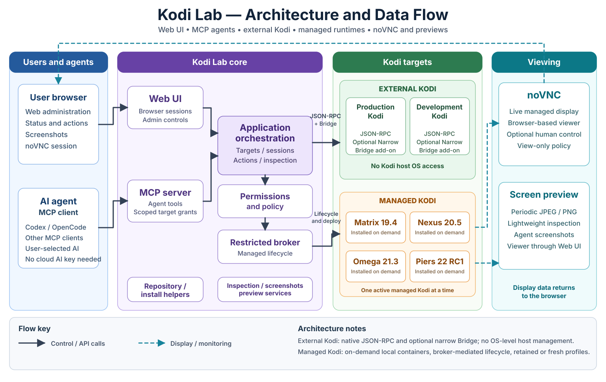

# Kodi Lab

For this development branch, see [Managed-v2 fresh installation](docs/MANAGED-V2-FRESH-INSTALL.md).

**Agent-operated Kodi add-on development and testing, with a simple operator Web UI.**

Kodi Lab provides a Web interface and a permission-controlled Model Context
Protocol (MCP) server for working with Kodi. Connect installations you already
use, or install isolated Kodi runtimes on demand to develop, test, and debug
add-ons.

Bring any compatible AI client and model you choose. Kodi Lab does not run an AI
model or require cloud AI credentials of its own. It is intended for Kodi add-on
developers, Kodi users who want diagnostics or controlled automation, and people
using MCP-compatible coding agents.

## Features

- Connect existing Kodi installations using JSON-RPC and the optional Narrow
  Bridge add-on, without OS-level access to those hosts.
- Install reviewed Kodi versions on demand and switch between isolated profiles;
  **only one managed Kodi instance runs at a time**.
  Broker admission prevents a second writable profile for the same version;
  conflicting older profiles require administrator review without automatic deletion.
- Grant **Trusted Managed Lab** once so an agent can create or import its own
  projects, edit, deploy, launch, inspect and Reset installed managed versions.
- Inspect Kodi UI state and capture screenshots. View supported managed Kodi
  through [noVNC](docs/STANDARD-NOVNC.md) (about 2 FPS, view-only by default,
  with optional human control; no audio).
- Keep external Kodi under independent per-device permissions, including for
  agents that already have Trusted Managed Lab authority.
- Use the Web UI to install managed versions, connect external Kodi, authorize
  agents, view screens and Take Control.

## Architecture at a glance



Web and MCP share Kodi Lab's control and permissions layer. The restricted
broker manages containers; external Kodi uses its authorized interfaces.
The diagram is a conceptual overview. See [architecture](docs/ARCHITECTURE.md)
and [security](SECURITY.md) for the implementation boundaries.

## Managed and external Kodi

After signing in, **Overview** (`/kodi`) links to three choices:

| Choice | Use it to |
| --- | --- |
| **Managed Kodi** (`/managed-kodi`) | Run Kodi hosted by Kodi Lab for testing, with a separate profile per version. |
| **External Kodi** (`/external-kodi`) | Connect an existing household or development Kodi, with independent permissions. |
| **Agents** (`/mcp-clients`) | Connect an agent and deliberately grant its managed or external authority. |

Managed setup acquires a reviewed image, then prepares an independent profile and
its authenticated Narrow Bridge. Trusted agents use private workspaces and
snapshots through MCP. See the [fresh-install walkthrough](docs/MANAGED-V2-FRESH-INSTALL.md).

External registrations, reviewed Bridge pairing and agent permissions are
administered independently for production and development targets.

## Requirements

- **Ubuntu 24.04 on 64-bit Intel/AMD (x86_64/amd64)** is the qualified host baseline.
- **Docker Engine and Compose V2 (2.24.4 or newer)**, with Docker access for
  your user. Follow
  [Docker's Ubuntu installation guide](https://docs.docker.com/engine/install/ubuntu/).
  Rootless Docker is not qualified for managed runtimes.
- **Python 3.12, Git, Bash, iproute2, sha256sum and [uv](https://docs.astral.sh/uv/getting-started/installation/)**.
  The Ubuntu download example also uses `curl`; a browser download works too.
- Internet access for Python packages, container images and upstream Kodi downloads.
- Capacity for application images and each Kodi instance. Piers acquisition
  requires at least **8 GiB free staging space**, plus space for Docker images and profiles. There
  is no qualified universal RAM minimum; begin with one running instance.

Setup installs Python build/test packages automatically; editors and AI clients
are optional.

**Windows 11 with Ubuntu 24.04 WSL2 and Docker Desktop's Linux engine** is also
qualified within its tested scope: fresh installation, cold Omega acquisition,
native viewing/control, agent-owned project development and backup/recovery.
Follow the [Windows installation path](docs/WINDOWS-WSL2-INSTALL.md).
[Acceptance #275 is complete](https://github.com/kcook98765/kodi-lab/issues/275#issuecomment-6870625793);
new or changed workflows require their own validation.
macOS and ARM64/Raspberry Pi hosts are not qualified. An existing Kodi target can
be on another computer; these requirements apply to the Kodi Lab server.

## Quick Start — Install Kodi Lab

These steps install Kodi Lab for the first time. Kodi is acquired separately
when you use **Create Managed Kodi** after signing in.

Choose how to access the Web UI **before installing**:

| Where you will use Kodi Lab | Access choice |
| --- | --- |
| Only on the installation computer | **Default local HTTP:** `http://127.0.0.1:18100/login`. Simplest option; no certificate or proxy required. |
| From other devices on a trusted private network | **Optional Ubuntu LAN HTTP:** choose `--web-lan-ip` during a fresh installation, as shown below. No certificate required. |
| With encrypted browser access | **Optional HTTPS:** requires the [supported proxy configuration](docs/WEB-NETWORKING.md#https-with-a-user-managed-proxy) and certificate trust before login. |
| On Windows/WSL2 | Follow the separate [Windows networking instructions](docs/WINDOWS-WSL2-INSTALL.md); Ubuntu's LAN HTTP flag is unavailable there. |

With the prerequisites installed, download and run one installer script.
On **Ubuntu**, use Bash:

```sh
curl -fL https://raw.githubusercontent.com/kcook98765/kodi-lab/main/scripts/install.py -o install-kodi-lab.py
python3 install-kodi-lab.py bootstrap
```

For **LAN Web access on a fresh Ubuntu installation**, replace the second command with:

```sh
python3 install-kodi-lab.py bootstrap --web-lan-ip YOUR_PRIVATE_IPV4
```

Replace `YOUR_PRIVATE_IPV4` with a private IPv4 address assigned to the Ubuntu
server. After installation, open `http://YOUR_PRIVATE_IPV4:18100/login` from
another LAN device.
LAN HTTP sends passwords, sessions and screen/control traffic **unencrypted**.
Use it only on a trusted private network; never add router port forwarding or
expose it publicly. See [Web networking](docs/WEB-NETWORKING.md) for details.

On **Windows**, use PowerShell after enabling Ubuntu's Docker Desktop/WSL2 integration:

```powershell
Invoke-WebRequest -UseBasicParsing https://raw.githubusercontent.com/kcook98765/kodi-lab/main/scripts/install-windows.ps1 -OutFile install-kodi-lab.ps1
.\install-kodi-lab.ps1
```

The scripts obtain a clean source checkout in the Linux user's data directory
and default to `~/kodi-lab-install`. Windows discovers that user's Linux home
automatically. No manual checkout path is needed. The selected source commit is
recorded; an exact commit can be selected with `--revision` / `-Revision`.

The scripts ask for your private LAN repository address, build/verify the
application bundle and initialize fresh state. After you choose the Web
administrator password, they start services. Open
**http://127.0.0.1:18100/login** on this computer,
sign in with your chosen password and continue
with [First-Time Setup](#first-time-setup). See the
[installer guide](docs/HOST-INSTALLER.md) for prerequisites, configuration,
start/stop and recovery. Windows users follow the
[WSL2 guide](docs/WINDOWS-WSL2-INSTALL.md), including its explicit repository
forwarding setup.

The prompted **Kodi add-on repository address** is separate from Web access.
Local agents use `http://127.0.0.1:18100/mcp` with separate bearer-token
authentication; Ubuntu's LAN Web listener rejects MCP.

For an existing installation, follow the documented
[mode-preservation and upgrade procedure](docs/WEB-NETWORKING.md#restarts-and-upgrades).
Do not rerun `bootstrap` or add installation flags to a restart to change
its saved access mode.

### Manual installation

Operators who want to run each bundle step themselves can use the
[manual Linux installation guide](docs/LINUX-SOURCE-INSTALL.md#clone-and-stage-the-application).

### Web access and optional HTTPS

**Local Web access works immediately after a fresh installation.** Open
[http://127.0.0.1:18100/login](http://127.0.0.1:18100/login) on the installation
computer. No certificates or reverse proxy are needed for local login or
standard noVNC viewing. The local MCP endpoint uses separate bearer-token
authentication.

For browsers on **another computer**, configure
[Web networking](docs/WEB-NETWORKING.md). Ubuntu offers an explicit private-LAN
HTTP option; HTTPS is also supported through a configured proxy. LAN HTTP is
**unencrypted**, including passwords, session cookies, screenshots, and control
traffic. Never expose it to the public Internet. Windows/WSL2 uses its separate
[networking guidance](docs/WINDOWS-WSL2-INSTALL.md).

<a id="web-https-prerequisite"></a>
In HTTPS mode, login and viewing require a trusted HTTPS/WSS proxy; see
[HTTPS configuration](docs/WEB-NETWORKING.md#https-with-a-user-managed-proxy).
The Kodi add-on repository has its own address and network configuration.

## First-Time Setup

1. Install the reviewed Omega runtime under **Kodi Runtimes** and wait for **Ready**.
2. Open **Managed Kodi**, select **Prepare** and **Start**, and wait for authenticated readiness.
3. Open **View Screen** for view-only noVNC. Use **Take Control** for human input and release it when finished.
4. Stop Kodi to preserve the working profile. Save a named snapshot before Reset if you want to keep that environment.

Under **External Kodi**, choose **External Production Kodi** or
**External Development Kodi** and follow the independent connection and pairing
workflow. See [external Kodi setup](docs/LINUX-V1-INSTALL.md#install-and-pair-a-remote-kodi-bridge).

## Develop an add-on

Grant the agent **Trusted Managed Lab** authority under **Agents**. The agent
acquires exclusive use of the working environment, admits a reviewed ZIP or
packages its private workspace, then asks Kodi Lab to install the exact package
through Kodi's native repository installer. Kodi resolves the declared
dependencies. Use direct source deployment for ordinary edits, and native
installation again when package or dependency requirements change. Stop Kodi
before saving or loading a snapshot. Release exclusive use when finished.

See the [MCP tool and permission reference](docs/MCP-TOOLS-AND-PERMISSIONS.md).

## Connect Your AI Agent

Open **Agents** (`/mcp-clients`) and use a separate client for each agent. Select
its purpose and deliberately grant the required authority:

- **Managed Kodi agent:** explicitly enable **Trusted Managed Lab** for autonomous
  development across installed managed versions. It grants no external access.

- **External Production Kodi:** choose **Production Inspection**, grant
  that Kodi, then **Grant current inspect scope**. This preset is production-only.
- **Limited managed inspection:** open **Advanced → Managed Kodi — Read-only
  inspection** in the connection guide. Select your existing client and exact Kodi; the next-step guidance opens
  the existing controls for an inspect-only custom preset, Kodi policy and target
  grant. Reuse a suitable preset or explicitly save one with only `target.inspect`.
  Supported screenshots use this inspection permission. Each change requires an
  explicit save; no client, grant or credential is created while browsing setup.

Issue a token and save it in the agent's private environment. A token does not
replace the role or independent external Kodi policy and grant. Keep a suitable client and
unexpired credential rather than creating another for each connection.

### MCP tools and permissions

- **Managed Kodi:** explicitly grant **Trusted Managed Lab** for development
  across installed approved disposable versions; limited inspection is separate.
- **External Production:** exact-device inspection grants; screenshots and remote
  navigation default Off. Select and development operations are prohibited.
- **External Development:** pairing grants no agent access; inspection, control
  and deployment depend on separate policies, target grants and verified support.

**[Complete MCP tool and permission reference](docs/MCP-TOOLS-AND-PERMISSIONS.md)**
— every tool, defaults, administrator controls and runtime prerequisites.

For **OpenCode on the same computer**, add this to
`~/.config/opencode/opencode.json`, merging it with any existing settings:

```json
{
  "mcp": {
    "kodi-lab": {
      "type": "remote",
      "url": "http://127.0.0.1:18100/mcp",
      "oauth": false,
      "headers": {
        "Authorization": "Bearer {env:KODI_LAB_MCP_TOKEN}"
      }
    }
  }
}
```

Set the token without putting it in a command argument, then launch OpenCode:

```sh
read -r -s -p "Token from Agents: " KODI_LAB_MCP_TOKEN
export KODI_LAB_MCP_TOKEN
opencode
```

Ask the agent to discover its available tools with MCP `tools/list`. Use
`managed_status` for the shared managed environment. Use `target_list` and the
returned exact `target_id` for external Kodi.

## Supported Kodi Versions

| Managed runtime | Status |
| --- | --- |
| Kodi 19 Matrix **19.4** | Stable runtime |
| Kodi 20 Nexus **20.5** | Stable runtime |
| Kodi 21 Omega **21.3** | Stable runtime |
| Kodi 22 Piers **22.0 RC2** | **Preview / Prerelease — Development only** |

These are the reviewed Linux amd64 runtime options; Kodi executables are acquired
on demand, not included in Kodi Lab. Piers RC2 is prerelease development software.
Retained RC1 profiles keep their original version and provenance; selecting RC2
does not replace an occupied Piers slot. See the [RC2 qualification](docs/PIERS-RC2-QUALIFICATION.md).
Standard noVNC viewing is qualified only for
[exact reviewed recipe revisions](docs/STANDARD-NOVNC.md), not automatically for
older profiles. Kodi Lab remains a prerelease development/testing project.
The owner accepted the documented
[viewer reliability risk](docs/STANDARD-NOVNC.md#known-first-connection-limitation)
for release; new reproducible failures still require investigation.
[Windows successor image retention](https://github.com/kcook98765/kodi-lab/issues/365)
remains a separate upgrade-safety follow-up. Earlier
[RC1 test checkpoints](docs/RC1-TESTING-CHECKPOINT.md) are historical records.
See the [agent-first qualification report](docs/AGENT-FIRST-QUALIFICATION.md)
for historical native Nexus/Omega evidence, and the
[Matrix/Piers native follow-up](docs/MATRIX-PIERS-AGENT-QUALIFICATION.md)
for the Matrix r4 and historical Piers RC1 native development paths. The
[RC2 report](docs/PIERS-RC2-QUALIFICATION.md) records the newer preview and its limits.

## Documentation

- **Getting started:** [Installer and everyday management](docs/HOST-INSTALLER.md),
  [Linux manual installation and capacity](docs/LINUX-SOURCE-INSTALL.md),
  [Windows/WSL2 setup](docs/WINDOWS-WSL2-INSTALL.md), and
  [Web access and optional HTTPS](docs/WEB-NETWORKING.md).
- **Kodi and add-on development:** [Current Managed Kodi walkthrough](docs/MANAGED-V2-FRESH-INSTALL.md),
  [external Kodi and repository setup](docs/LINUX-V1-INSTALL.md),
  [UI inspection](docs/UI-OBSERVATION.md).
- **Diagnostics:** [System information](docs/SYSTEM-INFO.md) and
  [bounded log reads, searches and counts](docs/KODI-LOGS.md).
- **Agents and architecture:** [MCP tools and permissions](docs/MCP-TOOLS-AND-PERMISSIONS.md),
  [remote-agent networking](docs/NATIVE-LAN-MCP.md), and
  [architecture and security boundaries](docs/ARCHITECTURE.md).
- **Operations:** [Managed state recovery](docs/MANAGED-V2-FRESH-INSTALL.md#state-and-recovery),
  [backup, upgrade and rollback](docs/LINUX-V1-UPGRADE-ROLLBACK.md),
  and [optional repository HTTPS](docs/REPOSITORY-NETWORKING.md).
- **Project:** [Contributing](CONTRIBUTING.md),
  [Code of Conduct](CODE_OF_CONDUCT.md), [security reporting](SECURITY.md),
  and [accessibility](ACCESSIBILITY.md).

Agents can act only on targets and operations you authorize. Web and Kodi
containers do not receive the Docker socket; the restricted broker manages
container lifecycle.

## Support

Report problems through [GitHub Issues](https://github.com/kcook98765/kodi-lab/issues).
Support development through [GitHub Sponsors](https://github.com/sponsors/kcook98765).

## License

Kodi Lab and its Bridge are [MIT licensed](LICENSE). Upstream Kodi and other
components retain their own licenses; see [third-party notices](THIRD_PARTY_NOTICES.md).
Kodi Lab is independent of the Kodi project and is not an official Kodi product.
