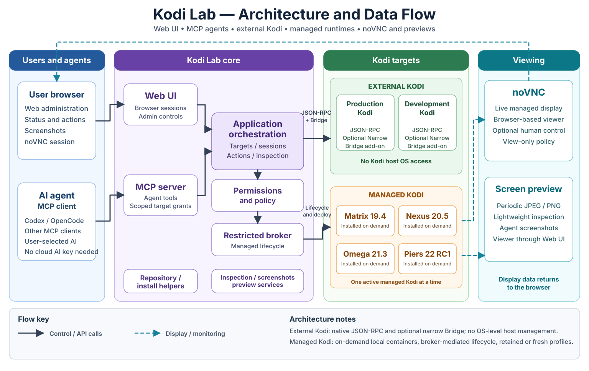

# Kodi Lab

**Self-hosted Kodi development, testing, and MCP integration for AI agents.**

Kodi Lab provides a Web interface and a permission-controlled Model Context
Protocol (MCP) server for working with Kodi. Connect installations you already
use, or install isolated Kodi runtimes on demand to develop, test, and debug
add-ons.

Bring any compatible AI client and model you choose. Kodi Lab does not run an AI
model or require cloud AI credentials of its own. It is intended for Kodi add-on
developers, Kodi users who want diagnostics or controlled automation, and people
using MCP-compatible coding agents.

## Features

- Connect existing Kodi installations using JSON-RPC and the optional Narrow
  Bridge add-on, without OS-level access to those hosts.
- Install reviewed Kodi versions on demand and switch between isolated profiles;
  **only one managed Kodi instance runs at a time**.
  Broker admission prevents a second writable profile for the same version;
  conflicting older profiles require administrator review without automatic deletion.
- Develop and test one add-on workspace in **Current Kodi**, using disposable
  profiles or explicitly enabled retained profiles for each version.
- Inspect Kodi UI state and capture screenshots. View supported managed Kodi
  through [noVNC](docs/STANDARD-NOVNC.md) (about 2 FPS, view-only by default,
  with optional human control; no audio).
- Grant MCP-compatible agents access only to selected Kodi targets and
  explicitly authorized operations.
- Manage runtime installation, connections, permissions, and development
  workflows from the Web UI.

## Architecture at a glance



Web and MCP share Kodi Lab's control and permissions layer. The restricted
broker manages containers; external Kodi uses its authorized interfaces.
The diagram is a conceptual overview. See [architecture](docs/ARCHITECTURE.md)
and [security](SECURITY.md) for the implementation boundaries.

## Managed and external Kodi

**Managed Kodi** runs in isolated Docker containers on the Kodi Lab server.
Choose a reviewed version when you need it; the first setup downloads and
validates Kodi. For add-on development, **Current Kodi** keeps one workspace
and selected profile. Explicitly enable **Retained Kodi versions** to preserve
per-version profiles when switching; see the
[walkthrough](docs/DEVELOPMENT-SESSION.md#everyday-walkthrough).

**External Kodi** runs on your own device. **Add Kodi** connects it through
Kodi JSON-RPC and pairs the optional Narrow Bridge for additional capabilities.
Home inspection, screenshots, control and development have separate permission
requirements. Kodi Lab provides no general-purpose shell or OS access to that
device; see [external setup](docs/LINUX-V1-INSTALL.md#install-and-pair-a-remote-kodi-bridge).

## Requirements

- **Ubuntu 24.04 on 64-bit Intel/AMD (x86_64/amd64)** is the qualified host baseline.
- **Docker Engine and Compose V2 (2.24.4 or newer)**, with Docker access for
  your user. Follow
  [Docker's Ubuntu installation guide](https://docs.docker.com/engine/install/ubuntu/).
  Rootless Docker is not qualified for managed runtimes.
- **Python 3.12, Git, Bash, iproute2, sha256sum and [uv](https://docs.astral.sh/uv/getting-started/installation/)**.
  The Ubuntu download example also uses `curl`; a browser download works too.
- Internet access for Python packages, container images and upstream Kodi downloads.
- Capacity for application images and each Kodi instance. RC1 requires at least
  **8 GiB free staging space**, plus space for Docker images and profiles. There
  is no qualified universal RAM minimum; begin with one running instance.

Setup installs Python build/test packages automatically; editors and AI clients
are optional.

Windows 11 with WSL2, Ubuntu 24.04 and Docker Desktop has an owner-accepted
installation and native Omega result using the maintained
[Windows installation path](docs/WINDOWS-WSL2-INSTALL.md). Broader Windows
qualification and the [password-prompt](https://github.com/kcook98765/kodi-lab/issues/222)
and [Firefox setup](https://github.com/kcook98765/kodi-lab/issues/226)
acceptance checks remain separate.
macOS and ARM64 hosts are not qualified. An existing Kodi target can be on another
computer; these requirements apply to the Kodi Lab server.

## Quick Start — Install Kodi Lab

These steps install Kodi Lab for the first time. Kodi is acquired separately
when you choose **Create Kodi** after signing in.

With the prerequisites installed, download and run one installer script.
On **Ubuntu**, use Bash:

```sh
curl -fL https://raw.githubusercontent.com/kcook98765/kodi-lab/main/scripts/install.py -o install-kodi-lab.py
python3 install-kodi-lab.py bootstrap
```

On **Windows**, use PowerShell after enabling Ubuntu's Docker Desktop/WSL2 integration:

```powershell
Invoke-WebRequest -UseBasicParsing https://raw.githubusercontent.com/kcook98765/kodi-lab/main/scripts/install-windows.ps1 -OutFile install-kodi-lab.ps1
.\install-kodi-lab.ps1
```

The scripts obtain a clean source checkout in the Linux user's data directory
and default to `~/kodi-lab-install`. Windows discovers that user's Linux home
automatically. No manual checkout path is needed. The selected source commit is
recorded; an exact commit can be selected with `--revision` / `-Revision`.

It prompts for your private LAN repository address and Web administrator
password, then builds/verifies the application bundle, initializes fresh state
and starts services. Open **http://127.0.0.1:18100/login** on this computer,
sign in with your chosen password and continue
with [First-Time Setup](#first-time-setup). See the
[installer guide](docs/HOST-INSTALLER.md) for prerequisites, configuration,
start/stop and recovery. Windows users follow the
[WSL2 guide](docs/WINDOWS-WSL2-INSTALL.md), including its explicit repository
forwarding setup.

### Manual installation

Operators who want to run each bundle step themselves can use the
[manual Linux installation guide](docs/LINUX-SOURCE-INSTALL.md#clone-and-stage-the-application).

### Web access and optional HTTPS

**Local Web access works immediately after a fresh installation.** Open
[http://127.0.0.1:18100/login](http://127.0.0.1:18100/login) on the installation
computer. No certificates or reverse proxy are needed for local login or
standard noVNC viewing. The local MCP endpoint uses separate bearer-token
authentication.

For browsers on **another computer**, configure
[Web networking](docs/WEB-NETWORKING.md). Ubuntu offers an explicit private-LAN
HTTP option; HTTPS is also supported through a configured proxy. LAN HTTP is
**unencrypted**, including passwords, session cookies, screenshots, and control
traffic. Never expose it to the public Internet. Windows/WSL2 uses its separate
[networking guidance](docs/WINDOWS-WSL2-INSTALL.md).

<a id="web-https-prerequisite"></a>
In HTTPS mode, login and viewing require a trusted HTTPS/WSS proxy; see
[HTTPS configuration](docs/WEB-NETWORKING.md#https-with-a-user-managed-proxy).
The Kodi add-on repository has its own address and network configuration.

## First-Time Setup

1. Sign in and open **Kodi → Create Kodi**. Leave **Omega · Recommended**
   selected for your first Kodi.
2. Review **Before you start**, then click **Create Kodi** once. Kodi Lab
   downloads and checks the files, prepares Kodi and starts it for you.
3. Keep the page open while **Preparing Kodi** advances to **Ready**. Setup can
   take several minutes. Returning or refreshing keeps the same saved setup.
   If it is paused, use **Check status**, then **Resume setup**.
4. Select **Open screen → Start Viewing** to see Kodi. Viewing starts view-only;
   an agent, Bridge pairing and a development workspace are not required.

Only one managed Kodi runs at a time. Connecting an agent is optional
and can wait until Kodi is ready. For add-on development, follow the
[Current Kodi walkthrough](docs/DEVELOPMENT-SESSION.md#everyday-walkthrough).
Manual runtime administration, including the Piers prerelease, remains under
Development; see the [advanced runtime guide](docs/LINUX-SOURCE-INSTALL.md#advanced-runtime-administration).

Save anything important before resetting or removing a disposable profile; see
[managed state recovery](docs/MANAGED-STATE-RECOVERY.md). Installing a newer
reviewed runtime recipe does not automatically migrate existing profiles.
**Stop retains the same profile; Reset deliberately discards its writable Kodi
data.** Independent source/workspace/Git state has its own retention controls.
The version-oriented **Status → Start → Use → Reset or Stop** workflow is being
implemented in stages under [issue #238](docs/ISSUE-238-MANAGED-SLOTS.md).
This first stage establishes admission fences; existing MCP lifecycle tools
still require an already provisioned, explicitly authorized target.

To connect an existing Kodi installation instead, use **Add Kodi** and its
pairing workflow. See [external Kodi setup](docs/LINUX-V1-INSTALL.md#install-and-pair-a-remote-kodi-bridge),
[reconnection](docs/KODI-RECONNECT.md), and
[repository address recovery](docs/REPOSITORY-ADDRESS-RECOVERY.md).

## Connect Your AI Agent

Open **Agents** in Web and use a separate client for each agent. Choose the
read-only setup for your kind of Kodi:

- **Home Kodi added with Add Kodi:** choose **Production Inspection**, grant
  that Kodi, then **Grant current inspect scope**. This preset is Home-only.
- **Kodi created by Kodi Lab:** switch to **Development** view. Under
  **Advanced administration**, create a custom preset using **Read-only
  Inspection** as the permission ceiling and select only **Inspect Kodi health,
  add-ons and UI state** (`target.inspect`). Choose that preset for the client
  and your Kodi's policy, then grant only that Kodi. A new Kodi's unassigned
  policy denies access. The built-in **Read-only Inspection** preset also
  includes screenshot permission; the custom preset keeps inspection-only access.

Issue a token and save it in the agent's private environment. A token does not
replace the Kodi policy or target grant. Keep an existing suitable client and
unexpired credential rather than creating another for each connection.

For **OpenCode on the same computer**, add this to
`~/.config/opencode/opencode.json`, merging it with any existing settings:

```json
{
  "mcp": {
    "kodi-lab": {
      "type": "remote",
      "url": "http://127.0.0.1:18100/mcp",
      "oauth": false,
      "headers": {
        "Authorization": "Bearer {env:KODI_LAB_MCP_TOKEN}"
      }
    }
  }
}
```

Set the token without putting it in a command argument, then launch OpenCode:

```sh
read -r -s -p "Token from Agents: " KODI_LAB_MCP_TOKEN
export KODI_LAB_MCP_TOKEN
opencode
```

Ask the agent to list its Kodi targets, inspect the chosen Kodi's health, then
list its add-ons. Native managed status and add-on inspection need no Bridge
setup. Screenshots require visual permission; richer UI/log inspection can
require optional Bridge setup. Each tool uses the selected target's ID.
Configuration syntax and compatibility vary by client.
See [OpenCode's MCP instructions](https://opencode.ai/docs/mcp-servers/),
the [client compatibility notes](docs/PHASE11-MCP.md#final-client-and-conformance-matrix)
and [setup for agents on another computer](docs/NATIVE-LAN-MCP.md).

## Supported Kodi Versions

| Managed runtime | Status |
| --- | --- |
| Kodi 19 Matrix **19.4** | Stable runtime |
| Kodi 20 Nexus **20.5** | Stable runtime |
| Kodi 21 Omega **21.3** | Stable runtime |
| Kodi 22 Piers **22.0 RC1** | **Preview / Prerelease — Development only** |

These are the reviewed Linux amd64 runtime options; Kodi executables are acquired
on demand, not included in Kodi Lab. Piers RC1 is not a stable Home recommendation.
Standard noVNC viewing is qualified only for
[exact reviewed recipe revisions](docs/STANDARD-NOVNC.md), not automatically for
older profiles. Kodi Lab remains a prerelease development/testing project.
Known prerelease concerns include the
[Nexus first-viewer disconnect](docs/STANDARD-NOVNC.md#known-first-connection-limitation)
and the Windows acceptance items above. Earlier
[RC1 test checkpoints](docs/RC1-TESTING-CHECKPOINT.md) are historical records.

## Documentation

- **Getting started:** [Installer and everyday management](docs/HOST-INSTALLER.md),
  [Linux manual installation and capacity](docs/LINUX-SOURCE-INSTALL.md),
  [Windows/WSL2 setup](docs/WINDOWS-WSL2-INSTALL.md), and
  [Web access and optional HTTPS](docs/WEB-NETWORKING.md).
- **Kodi and add-on development:** [Current Kodi walkthrough](docs/DEVELOPMENT-SESSION.md),
  [external Kodi and repository setup](docs/LINUX-V1-INSTALL.md),
  [managed development workflow](docs/MANAGED-AGENT-LOOP.md), and
  [UI inspection](docs/UI-OBSERVATION.md).
- **Agents and architecture:** [MCP development reference](docs/PHASE12-MCP-DEVELOPMENT.md),
  [remote-agent networking](docs/NATIVE-LAN-MCP.md), and
  [architecture and security boundaries](docs/ARCHITECTURE.md).
- **Operations:** [Managed state recovery](docs/MANAGED-STATE-RECOVERY.md),
  [backup, upgrade and rollback](docs/LINUX-V1-UPGRADE-ROLLBACK.md),
  and [optional repository HTTPS](docs/REPOSITORY-NETWORKING.md).
- **Project:** [Contributing](CONTRIBUTING.md),
  [Code of Conduct](CODE_OF_CONDUCT.md), [security reporting](SECURITY.md),
  and [accessibility](ACCESSIBILITY.md).

Agents can act only on targets and operations you authorize. Web and Kodi
containers do not receive the Docker socket; the restricted broker manages
container lifecycle.

## Support

Report problems through [GitHub Issues](https://github.com/kcook98765/kodi-lab/issues).
Support development through [GitHub Sponsors](https://github.com/sponsors/kcook98765).

## License

Kodi Lab and its Bridge are [MIT licensed](LICENSE). Upstream Kodi and other
components retain their own licenses; see [third-party notices](THIRD_PARTY_NOTICES.md).
Kodi Lab is independent of the Kodi project and is not an official Kodi product.
