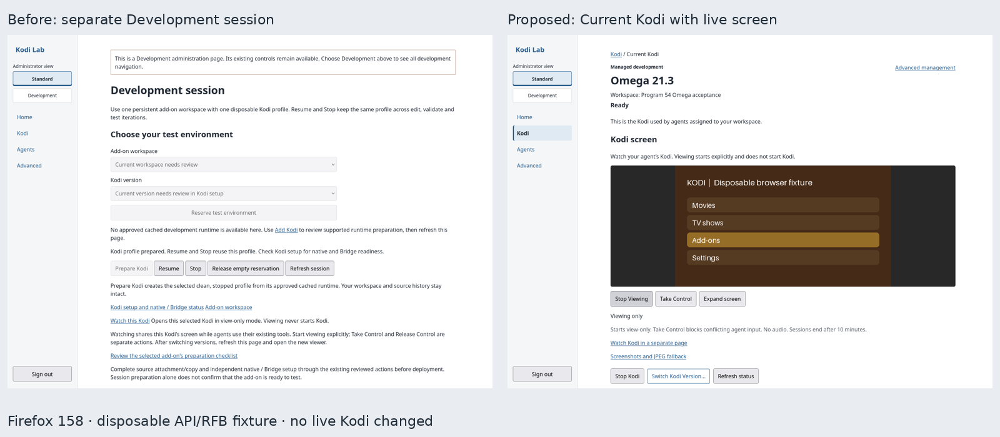

# Current Kodi: one add-on, one development environment

Use **Kodi → Current Kodi** (`/development-session`) for one persistent add-on workspace
and one disposable Kodi profile. This guide describes the composed feature-branch
workflow. Code review and source tests do not install it into an existing Lab;
matched application, broker and schema deployment and native/platform acceptance
remain separate. Existing runtime/version eligibility still decides which cached
versions can be selected.

The page always follows the durable selected development session. A stopped
selection remains Current Kodi. Opening an older registration does not select it;
its Advanced page identifies it as noncurrent. Home and Kodi link here in both
administrator views. Household and external Kodi retain their separate management.

The live screen reuses the existing noVNC controller and private transport for
only the qualified, explicitly enabled Omega r4 instance. **Start Viewing** is
explicit and defaults to view-only; **Stop Viewing** leaves Kodi running.
**Take Control / Release Control** retain exclusive server-enforced input
ownership and the original ten-minute deadline. Stop Kodi holds the existing lifecycle exclusion while it verifies viewer
release before dispatch; fresh admission is refused under that claim. An uncertain release blocks Stop;
no queued action is replayed. An expanded page opened without a selected, bound
profile has no viewing controls and links back to Current Kodi. A changed environment retires the old panel and
requires a page reload and fresh explicit viewing. Admission and control handoff
recheck the rendered session and profile, so an old page cannot attach a fresh
profile on the same registration. Other runtimes gain no noVNC
qualification. Screenshots, JPEG preview and browser remote remain in Advanced.

Native readiness, stored development prerequisites and a particular agent's
permissions remain separate. A running container or saved Bridge record is not
shown as complete development readiness. Runtime installations now distinguish
canonical acquisition from separately reviewed development variants; a newer r4
record does not make the canonical r2 installation appear unavailable. All recorded
failures remain inspectable under **Advanced → Reviewed runtime installations**.

Advanced retains exact instance pins, Bridge/source/ZIP administration, recovery,
resource policy, logs/diagnostics/activity, snapshots, reset, runtime removal and
deletion. These operations keep their existing eligibility and confirmations.

## Interface comparison

Firefox 158 against disposable API/RFB fixtures using the actual templates,
styles and viewer controller. This image demonstrates navigation and layout; it
does not establish native Kodi, authenticated MCP or physical-device acceptance.

## Everyday walkthrough

1. **Choose the add-on and version.** Select a ready workspace and eligible
   approved cached Kodi version, then **Choose Kodi**. If another
   managed profile or unresolved operation blocks reservation, review it through
   existing setup/history. The session does not adopt or remove it. Use **Advanced → Reviewed runtime installations** separately when an eligible cached runtime is unavailable.
2. **Prepare the stopped profile.** Use **Prepare Kodi**, then open **Review development setup**. Preparation creates the clean
   stopped profile; it does not install the add-on, confirm native readiness or
   establish reviewed Bridge trust. Review uncertain history before another
   action. An empty inventory after a lost create reply does not permit retry.
3. **Copy the registered source baseline.** If needed, explicitly attach the
   selected registered source through the linked Kodi setup. Back on the
   checklist, use **Copy registered source baseline into stopped Kodi**. This
   may replace add-on files in that profile; it does not deploy private workspace
   edits. Saved request links recover a lost reply. Refresh reads progress only;
   **Continue this queued copy** can continue the same still-queued request.
4. **Start and complete native setup.** Use **Start Kodi**, review the linked
   native and Bridge status separately, and use the existing supported source
   enablement/setup controls as required. A saved baseline or session binding
   does not prove that the add-on is enabled, Kodi is usable, a Bridge is active,
   or a native prompt has been resolved. Follow the exact installed version's
   reviewed continuation; grants and pairing credentials are not copied.
5. **Iterate in the same profile.** Edit and validate the workspace, check
   deployment preflight, then deploy/test that exact generation through the
   existing authorized workflow. See the [agent development loop](MANAGED-AGENT-LOOP.md).
   Use **Stop Kodi** and **Start Kodi** to keep the same profile between iterations.
   Source changes do not require Fresh Test or Kodi image rebuilds.
6. **Fresh Test or Switch Version deliberately.** Stop the current test, save
   diagnostics from that exact profile, then open **Switch Kodi Version…** or **More options → Fresh Test…**.
   Select the cached version and 1–8 retained captures. Saving a review only holds
   evidence and keeps the profile. The separate **Replace profile and prepare
   selected test** confirmation names the exact profile and data loss. A confirmed
   retirement is required before the next stopped profile can be prepared.
   Reestablish its source baseline and independent native/Bridge setup.
7. **Recover from saved state.** Refresh the original copy/replacement status
   after a lost reply. If retirement is confirmed but preparation is blocked,
   review **Continue preparation** or **Release retired reservation**. These do
   not settle an unknown removal/create. **Release empty reservation** closes
   only an absent, idle ordinary reservation; it does not delete a profile.

Persistent source, workspace, Git history and explicitly retained captures stay
outside Kodi. Fresh/Switch permanently removes the displayed writable profile,
including settings, installed add-ons and unselected artifacts. Saved excerpts
can be partial; referenced crash-report metadata does not collect report bodies
or establish cause. Review the displayed evidence and loss before confirming.
No idle timeout, automatic profile cleanup or background replacement is added.

## Admission and persistence

This opt-in foundation reserves one logical add-on/workspace, canonical target,
exact runtime revision and session generation. Presence of an active policy
pointer enables the restriction; migration creates empty tables and does not
activate it, enroll any existing resource or change grants. There is no new MCP
lifecycle/create/reset/delete authority. Web composition owns preparation.

Initial reservation requires no managed containers, no in-flight start/provision
reservation, no instance mutation lease and no global-heavy lease. Every stopped
container still occupies the provisioned environment. Existing unrelated resources
cause a conflict; no name-based cleanup, implicit adoption or eviction occurs.
Canonical identity and current approved runtime eligibility are rechecked using
the existing policy, including immutable cached artifact/profile/provenance proof.
This initial entry point permits stable/current and legacy releases; prerelease
selection needs its existing explicit preview acknowledgement in a later Web flow.
No runtime/image acquisition happens here.

All production broker provision paths now persist a reservation before Docker
dispatch, including when the opt-in policy is inactive. Session reservation and
provision/start admission use the same SQLite writer boundary. A delayed Advanced
provision therefore cannot race a new session's apparent empty inventory. A session
also constrains existing Advanced, reset and agent start paths at the broker; a
page-only guard or max_running=1 would leave a second stopped container possible.
Uncertain reservations survive process restart and never expire into a free slot.
Only known network/image preflight errors, raised before any create, release their
reservation and retain the prior session phase.

Phases are reserved → provisioning → bound, or uncertain after an unverified
outcome. Binding requires the exact post-provision target/runtime/container/image
inventory. Initial creation cannot adopt an existing idempotent result. The
selected profile can stop/resume without advancing session generation. If it
vanishes, an Advanced retry cannot silently replace it. An explicit absent/idle
close retains generation history and allows a new deliberate reservation.

An uncertain provision cannot be released merely because inventory is currently
empty: an accepted daemon create may still complete after a transport timeout.
The reservation remains fenced across restart, even after the application lease
ends. A future supported settlement review needs independently verified dispatch
completion, not an operator checkbox or inferred timeout. No automatic expiry or
absence-only clearing API is provided. An ordinary reserved/bound session can
close only with proven absence and no pending reservation/lease.

Workspace/source/history remain outside the profile. Workspace cleanup refuses
session references before removing bytes. Retained generations are capped at 256;
capacity exhaustion requires review, not automatic history deletion.

Migration 0080 adds the session history, singleton pointer and provision reservation
tables with foreign-key/check constraints. There is no data backfill, security
policy migration or resource removal. Populated history/reservations refuse lossy
downgrade. An older broker/application cannot enforce this opt-in policy; deployment
must update matched application/broker/schema bytes together and preserve backup/
recovery. Migration and deployment are separately authorized operational work.

The reservation service itself dispatches no retirement or replacement. The
separate reviewed composition described below performs those steps through the
existing exact lifecycle authority. Source attachment/copy and native/Bridge setup
retain their independent checks. Existing recovery fences remain authoritative;
native sequential version-switch and Windows acceptance remain separate
qualifications.

## Minimal Web workflow

Open **Kodi → Current Kodi**. Select one ready workspace and an
eligible approved cached canonical runtime, then reserve the empty environment.
**Prepare Kodi** creates only the selected clean stopped profile. **Start Kodi** and
**Stop** reuse its exact container without resetting source iterations. Links lead
to the selected Kodi's existing source/Bridge/native setup and workspace actions.
Preparation alone is not an assertion of deployment or capability readiness.

All actions use authenticated Web administration, Origin/CSRF checks and the
current session generation. Preparation rechecks runtime eligibility inside the
existing lifecycle claim; Resume/Stop recheck exact target/runtime/container before
dispatch. Stale bindings and unknown inventory refuse actions. Lost/failed browser
responses disable resubmission and direct the operator to status/history review.
No polling scheduler, image acquisition, new MCP tool or new grant is added.

**Release empty reservation** only closes an absent, idle ordinary session; it
never removes a profile or clears uncertain provision. Fresh Test/Switch uses the
separate evidence review and final confirmation described below. Existing unrelated
containers block reservation and are preserved. Native and Windows acceptance
remain separate from the route/Node/fixture evidence for this page.

## Save a Fresh Test / Switch review and hold evidence

The session page links to **Switch Kodi Version…** or **More options → Fresh Test…**. Stop the current
session through the existing action, save diagnostics for that exact test, then
select the approved cached version and 1–8 retained captures. The ordinary form
displays the current session/container and next immutable runtime/image. It
requires acknowledgement that native crash reports are uncollected and excerpts
can be incomplete. Saving holds the selected bodies against explicit discard.
This is a durable review step; it does not execute retirement or replacement.

Migration 0082 adds two initially empty review/hold tables after 0081. A review
binds the exact current generation, runtime, container, image, workspace
generation/tree digest, source/add-on, next target/revision/image and selected
capture IDs/digests. The same target means Fresh Test; a different canonical
target means Switch Version. Cached runtime eligibility, one exact stopped
container, no other managed resources, busy/uncertain reservations and stored
reconciliation are rechecked inside SQLite writer admission. Capture bodies and
their historical identity/hash/typed schema are verified before the hold. No
source attachment, grants, baseline, Bridge trust or lifecycle evidence is copied.

Only one review can be open, with at most 128 retained review-history rows.
The 16 KiB UTF-8 snapshot bound and 2 GiB free-space reserve apply before
admission, including the actual database filesystem. Capacity refuses rather
than pruning. The request UUID replays its exact saved receipt even after a lost
response, process restart or later selection drift. It cannot be rebound to
another intent. Saving/cancellation uses Web authentication, same-origin and
CSRF checks; there is no new MCP authority or diagnostic-body exposure. Page
responses are non-cacheable. Review metadata links to private captured bodies.

Resume/Stop remain ordinary explicit actions. A saved review records facts at
creation; it does not freeze the session or claim that those facts stay current.
Final execution requires fresh eligibility/identity/lease/reconciliation and
evidence checks, exact confirmed retirement and an atomic next reservation.
Ordinary unscoped lifecycle history cannot supply an exact original-container
retirement witness by inference; the separate scoped receipt below is required. Unknown Docker creates remain fenced.
Missing inventory, elapsed time and service restart do not settle dispatch.

An absent session cannot be released while its review is open. **Cancel review**
requires its displayed snapshot digest and explicit confirmation. It releases
only that review's holds, preserves the saved review/capture history and leaves
the session, current profile and all other fences intact. Retained bodies can
then be separately discarded through their existing reviewed action. Saving or
cancelling a review alone performs no profile removal or runtime mutation and
adds no worker, automatic expiry or scheduler.
Populated review history refuses lossy downgrade even after cancellation. A
matched reader/application/schema is required to enforce holds; migration,
deployment, existing-resource execution and native/Windows acceptance remain
separately authorized work.

## Exact retirement receipt foundation

The trusted lifecycle service now accepts an optional exact disposable-runtime
scope for deprovision: original target, immutable revision/image and container.
This is an internal composition boundary, not a new Web/MCP action or grant.
Saving the Fresh/Switch review alone performs no retirement or replacement;
its separate final execution uses this exact receipt.

New empty migration 0083 adds `managed_runtime_retirements`. An exact prepared
scope and child lifecycle operation are claimed together under the existing
mutation lease. Stored pin/type/image are checked before claim; the actual
leased action checks current container/runtime/image again before clearing
readiness or invalidating trust/deployment evidence. Existing unscoped Advanced
deprovision does not invent or backfill exact witnesses for historical actions.

Only the exact broker removal reply followed by an unprovisioned lifecycle
postcondition can publish confirmation. Confirmation, successful terminal record,
owned projection and lease release commit in the same transaction. Failure to
publish rolls back terminalization and retains ownership for existing recovery;
cancellation after commit leaves the confirmed receipt intact. A lost or
mismatched reply, failed postcondition, interrupted dispatch or lost lease cannot
produce positive proof even when current inventory is empty. The new terminal
hook executes only after existing ownership guards and before history pruning.

Receipts preserve original identity outside disposable resources and protect
their exact lifecycle operation from pruning. Up to 256 scoped history rows are
admitted; exhaustion refuses before dispatch, without automatic overwrite or
pruning. Prepared/failed/unconfirmed and confirmed history all refuse lossy
downgrade. The typed read checks matching original operation/kind/state/time;
it never repairs or reconstructs proof from a historical success or absence.

A confirmed deprovision receipt does not settle an uncertain **create**, release
the old session, reserve a successor, copy trust/baselines or authorize another
destructive action. Those are separate steps. The explicit Fresh/Switch
composition below binds the reviewed intent to this exact operation, keeps
selected evidence held, and advances old closure plus new reservation atomically
under shared admission.
Current-source tests use fake lifecycle/broker transports and temporary migrated
SQLite; they establish no native or existing-resource execution acceptance.

## Explicit Fresh Test and sequential version switching

Stop the current test and save selected diagnostics, then save its exact review.
The separate final confirmation names the old stopped container/profile, the
approved cached next runtime/image and the evidence to retain. It explains that
the writable profile, installed add-ons, settings and unselected artifacts will
be lost, while source, workspace, Git history, runtime images and selected saved
captures remain. Native crash-report bodies remain uncollected; bounded referenced-report metadata
can still be incomplete. Recheck evidence before confirming replacement.

Final execution rechecks the whole review, selected body integrity, current
stopped identity, shared reservations/leases, stored reconciliation, cached
runtime eligibility and generation capacity before retirement. It binds the
explicit request and review digest to the exact owned retirement child in the
same claim transaction. Replays/status never redispatch; an unconfirmed removal
keeps the old session and evidence holds even when inventory is empty. There is
no timeout-, restart- or absence-based settlement action.

After the exact receipt confirms retirement, one SQLite writer transaction checks
the empty global inventory, no pending reservation/lease or retained reconciliation,
current approved immutable next pin/image, same ready workspace/source/add-on
and selected evidence. It closes the old session, inserts the next reserved
generation, switches the singleton policy pointer and consumes the review in
one commit. Exclusion is never disabled between close and reserve. Later
workspace edits stay in that persistent workspace; handoff neither copies nor
discards its bytes. It performs no automatic add-on deployment.

The existing lifecycle then prepares the selected clean **stopped** profile.
Source grants/attachment, deployment baseline and native/Bridge setup remain
independent reviewed actions; links lead to those existing controls. Nothing
inherits grants, credentials, paired trust, launch/deployment receipts or a
verified source baseline from the disposed profile. Resume/Stop and ordinary
source iterations continue in place on the new generation.

If retirement is confirmed but a later prerequisite changes, the old exclusive
reservation and evidence remain. **Continue preparation** advances that known
retirement without issuing another removal. **Release retired reservation**
explicitly closes only that proven retired empty slot, keeps saved evidence and
history, and permits a new deliberate version selection. It cannot release an
unconfirmed retirement or a pending/uncertain create. Cancellation of a review
is unavailable once its execution is claimed.

A failed next create uses the existing session/provision/lifecycle evidence.
Known pre-create refusals leave a reserved session for an explicit ordinary
Prepare action; unknown creates remain fenced. A lost reply or repeated final
POST returns its durable status. The original preparation UUID is retained in
the replacement record; ordinary bounded lifecycle-history pruning can make its
detail unavailable, which is reported without guessing another operation.
Retirement proof remains protected from pruning. No scheduler or automatic
cleanup/retry runs.

Migration 0084 adds replacement bindings and a nullable successor-generation
reference to existing reviews. A consumed review reports completed review state;
that means successor admission, not native or add-on readiness. One active review
remains enforced by a unique partial index. Existing snapshots and hold history
are preserved; populated execution/consumption refuses lossy downgrade. The
SQLite change adds a nullable referenced column without rebuilding a populated
parent or disabling foreign keys. Historical 0082/0083 fixtures retain their
actual schema vocabulary; current coordinator tests require the matched head.

Web actions require administrator authentication, exact boolean/checkbox final
consent, same-origin and CSRF. No MCP tool, preset or agent permission is added.
Implementation/tests do not authorize deployment, production migration, existing
resource removal or native sequential-version/Windows acceptance.

## Selected workspace admission

While a single-session policy is active, fresh managed workspace deployments,
smoke/negative execution and GUI launches must name that session's bound target,
runtime, workspace and source. Before runtime dispatch, the observed container
must also match. Reserved, uncertain or pending provision/start state refuses
these actions. Claim-time checks run inside existing SQLite writer claims before
mutation-lease reservation; ordinary session creation/replacement cannot race a
claimed workspace mutation. The broker's workspace-copy resolver independently
checks the same selection before reading deployment bytes.

This restriction supplies no grant or baseline. Existing source attachment,
validation, exact copied tree, runtime eligibility, native/Bridge identity and
operation authorization are still required. An authenticated historical receipt
replay retains its original meaning without redispatch. Offline workspace edits
and external-development targets use their existing separate paths. Inactive
session policy preserves existing managed behavior. This increment scopes the
workspace development path; it does not add generalized agent-managed session
creation, settings authority or native acceptance. Administrator source setup
and recovery remain separately reviewed operations.

The existing read-only deployment preflight reports the stored session restriction
and links to session review when it blocks work. Matching stored scope does not
prove a live container or native/Bridge/add-on readiness.

## Selected-session preparation checklist

The session page links to a private, read-only checklist for the currently
selected add-on and Kodi version. It reuses the deployment preflight and stored
Bridge capability prerequisites. Profile phase, source attachment, exact saved
baseline, workspace validation and unresolved operation history are shown beside
links to existing reviewed setup actions. No agent/client scope is inferred.

The service reads one SQLite transaction snapshot for session, workspace/source,
preflight, reconciliation and Bridge prerequisites. Projections may borrow that
read session without closing it; their ordinary callers retain existing behavior.
An explicit `BEGIN` followed only by reads keeps the composed identities together;
it does not reserve the writer slot. See SQLite's [isolation](https://www.sqlite.org/isolation.html)
and [transaction documentation](https://www.sqlite.org/lang_transaction.html).
A concurrent switch can leave the displayed generation historical, while the
snapshot stays internally consistent. An explicitly requested generation that is
already stale refuses; each later mutation still rechecks current admission.

The checklist projection never probes Kodi/Bridge/broker, reads credentials, schedules work,
creates/prunes operations, changes grants or updates health. Current container,
native/Bridge readiness, dialogs and enabled add-on remain unobserved/unknown.
HTML and JSON are administrator-authenticated and `no-store`; metadata is escaped.
Normal Web authentication last-use updates and the existing bounded retention
middleware remain in place; they are separate from the read-only projection.
This is setup guidance, not runtime or native/platform acceptance. It does not
implement settings authority or automatic source setup/enablement.

## Current-profile deployment receipts

A Fresh Test on the same Kodi version can retain the same target, workspace and
source generation while replacing its container. When a session is active, fresh
workspace execution, GUI launch and prior-workspace-copy selection therefore
require the receipt's exact original container/runtime/workspace/source/target
to match the selected bound profile. Historical or unscoped receipts remain
history; they do not establish deployment into its successor. A newly copied
source baseline must have its own positive current binding before deployment.

This avoids treating successes from two different profiles as ambiguous current
copies, while retaining ambiguity checks within the current profile. Exact old
request replay remains historical and never redispatches; recovery keeps its
original scope. Existing inactive-policy and external paths retain their
semantics. Receipt selection supplies no permission or live proof. Each later
operation still verifies current identity, copied bytes, readiness and grants.

## Stopped source-copy queue identity

New registered-source copy queues retain the stopped container identity observed
when queued, using the existing operation field. Acquire preserves that pin,
rechecks runtime/type/attachment and claims the same exact unclaimed mutation and
heavy-operation reservations in one writer transaction. A positive profile or
scope change fails the unclaimed request without copying into its replacement.
Only its exact unclaimed reservations are released. Claimed/running/foreign or
malformed work remains fenced; unknown inventory is not treated as completion.

A trusted queue precondition can bind a future guided action to the selected
session before any operation/lease reservation. This does not add an endpoint,
permission, request-id/replay guarantee or automatic source setup. Existing legacy
nullable queue rows keep claim-time binding; they do not gain retrospective queue
identity proof. The existing source executor remains the only worker. A guided
copy action still needs durable request attribution and current session admission.

### Durable source-copy requests

The selected stopped session can admit its already attached registered source
through a trusted application service. A durable request receipt binds the exact
session generation, target, runtime, workspace, source and container to the
existing Source copy operation and both operation reservations in one transaction.
This copies the registered source baseline; private workspace edits still need
validation and workspace deployment. On the preparation checklist, use
**Copy registered source baseline into stopped Kodi** after the selected source
has been explicitly attached through existing Kodi setup. The action derives
all scope from the selected session, rechecks its exact generation and current
stopped profile, and uses existing Source validation and typed reservations.

Retrying an identical request reads the original receipt. It does not queue a
replacement operation, even after bounded operation detail has been pruned or
the session has closed. Missing detail means the outcome is not retained, not
success or permission to repeat the copy. Request history is bounded without
automatic pruning (1,024 total, 32 per session generation); capacity needs review.
Source attachment, stopped exact identity and existing admission checks remain
mandatory. Unknown or running work is never reset by this service.

The checklist links saved copy requests for that session so a lost reply can be
recovered without making a new request. Receipt HTML/JSON reads stored progress
only; they never check Kodi or submit work. A still-queued original request can
be explicitly continued through the existing executor. It must retain exact
unclaimed reservations and still match the selected generation/profile. Running,
failed, uncertain, foreign or missing detail never resets or starts a new child.
An unacknowledged submission leaves the saved queue intact for review. Existing
executor startup handles its existing queued work; no scheduler or retry loop is
added by this flow.

Source copy now uses the shared selected-session admission at queue, worker and
broker boundaries. Guided children additionally retain their original generation,
even if a partial restore presents the same profile under a successor generation.
Inactive legacy work keeps its normal path after the current schema migration.
Current application/broker state requires migration0085; there is no missing-table
fallback. Unknown or changed selection preserves the operation fence. Positive
unclaimed container drift can still use the existing exact scoped refusal path.
This changes no agent grants or Bridge trust and does not enable or start Kodi.

### Selected-source enablement scope

Existing Web-admin enablement of a copied source is narrowed to the selected
source, target and runtime while session policy is active. Its initial claim is
metadata-only. Before native enablement it checks the observed running profile
and the same originally selected generation, while preserving all copied-tree,
identity, dependency and enabled-state checks. Preflight/mutation markers require
and renew the original unexpired typed lease; they cannot borrow foreign authority. Changed selection before dispatch
fails; uncertain native dispatch still requires existing reconciliation. It does
not create a new guided enablement action, automatically enable an add-on, change
permissions or treat historical enabled state as current proof.

### Queued registered-source smoke checks

Existing registered-source smoke work is narrowed to the selected source, target
and runtime. New queues retain the selected expected profile; the worker confirms
its actual running identity and keeps the acquired session selection through the
native invocation marker. It cannot rebind a positive profile pin or borrow foreign
operation authority. Unknown or malformed queued work remains for review.

This adds no new button, agent grant or retry loop. The existing running bound
stays 90 seconds. Older nullable records bind only when the current runtime is
observed; that does not establish their original queue-time identity. Native
invocation ambiguity and post-invocation provenance remain attached to the
original work. Current setup observations do not convert historical results into
native readiness, and refreshing stored history does not rerun a smoke test.
